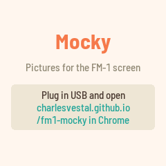
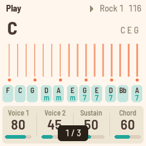
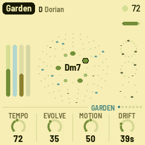

# Mocky for the M-VAVE FM-1

Mocky shows pictures on the FM-1's 240 × 240 screen, sent from a web page over the USB cable. It is
for checking screen mockups on the real hardware: the colours, the sizes, how text reads at arm's length.

  

- **Send pictures** (Chrome or Edge): <https://charlesvestal.github.io/fm1-mocky/app/>
- **Install it** (Chrome or Edge, with the FM-1 plugged in): <https://charlesvestal.github.io/fm1-mocky/install/>
- **Download the firmware file**: [releases](https://github.com/charlesvestal/fm1-mocky/releases)

- **Send a picture**: open the page in Chrome or Edge, click
  **Connect**, drop a picture. Fit, Fill, Stretch or 1:1; an optional dither for photos and gradients.
  The page shows exactly what the screen will show (RGB565).
- **Watch a file**: pick a file on disk and the page sends it again each time it changes (not kept):
  export from your design tool over the same file and the FM-1 follows.
- **The gallery**: pictures sent with "Keep" stay in the FM-1's flash (276 KB; flat mockups take
  a few KB each, a photo ~116 KB; up to 64), and the FM-1 starts on the last one shown.

On the FM-1:

| | |
|---|---|
| white keys | pictures 1–16 (their lights: the kept ones; the one shown blinks) |
| OCT− / OCT+, SELECT, ALGORITHM, PRESETS, KNOB 1–3 | previous / next |
| PLAY | slideshow on / off; KNOB 4 sets the pace (1–30 s) |
| SAVE | keep the picture just sent without "Keep" (it blinks while there is one) |
| HOME | which picture this is, and the room left |

### Screen reader

Mocky tells the [FM-1 Screen Reader](https://charlesvestal.github.io/fm1-reader/) what it shows, over USB:
which picture is on the screen ("picture 3 of 7"), a picture arriving from the page and whether it was kept,
the slideshow, the room left, and what each button did. A picture itself can't be put in words, so the
reader says what Mocky knows about it. Open the reader page in Chrome with the FM-1 plugged in; it speaks
with its own voice, or hands the text to your computer's screen reader. (Its SysEx, `F0 7D 53 52`, shares
the cable with the pictures' `F0 7D 4D`.)

Felucca's safety stays: OCT− + OCT+ held 5 s for update mode, safe mode after two failed starts, the
web installers can put any firmware (or M-VAVE's) back.

## Build, test, run

```sh
./build.sh                                   # build/mocky.fwsc (identity FM-1_100; --release X.Y)
sh tests/run_tests.sh                        # host tests, web coder, the whole app in the simulator (and the reader)
python3 tools/fm1_install.py build/mocky.fwsc --yes   # flash the attached FM-1
cd web && python3 -m http.server 8000        # then http://localhost:8000/ in Chrome
```

How it works: `web/mocky.js` scales the picture to 240 × 240, reduces it to RGB565 and run-length
codes it, then sends it in SysEx messages (`F0 7D 4D ...`), one reply each, resuming where the FM-1
says it is. `firmware/src/app/mock.c` takes them, checks the CRC, decodes into a framebuffer and,
if asked, appends it to the gallery in flash (0x97000–0xDBFFF, Felucca's data area). Both files
document the format and the protocol.

Built on [Felucca](https://github.com/hugelton/Felucca) by Leo Kuroshita (@kurogedelic), Hügelton
Instruments, by way of FoMni-1. GPL-3.0-only. M-VAVE and FM-1 are trademarks of their respective owners.
