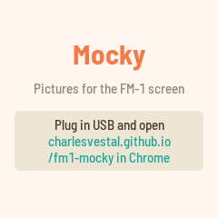
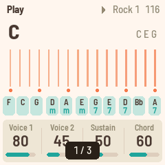
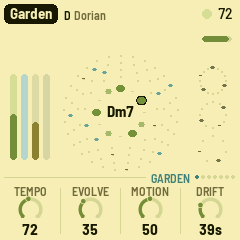

# Mocky for the M-VAVE FM-1

Mocky shows pictures on the FM-1's 240 × 240 screen, sent from a web page over the USB cable. Use it to
check your screen mockups on the real hardware: the colors, the sizes and how text reads at arm's length.

  

- **Send pictures** (Chrome or Edge): <https://charlesvestal.github.io/fm1-mocky/app/>
- **Install it** (Chrome or Edge, with the FM-1 plugged in): <https://charlesvestal.github.io/fm1-mocky/install/>
- **Download the firmware file**: [releases](https://github.com/charlesvestal/fm1-mocky/releases)

- To send a picture, open the page in Chrome or Edge, click **Connect** and drop a picture. Choose Fit,
  Fill, Stretch or 1:1, and turn on dither for photos and gradients if you like. The page shows exactly
  what the screen will show (RGB565).
- To watch a file, pick it on disk, and the page sends it again each time it changes. These copies
  aren't kept. Export from your design tool over the same file, and the FM-1 follows along.
- Pictures you send with "Keep" stay in the FM-1's flash, in its gallery. There's 276 KB of room, for up
  to 64 pictures. A flat mockup takes a few KB, and a photo about 116 KB. The FM-1 starts on the last one
  you looked at.

On the FM-1, use these controls:

| | |
|---|---|
| white keys | show pictures 1–16. A key lights when its picture is kept, and the one shown blinks |
| OCT− / OCT+, SELECT, ALGORITHM, PRESETS, KNOB 1–3 | step to the previous or next picture |
| PLAY | starts or stops the slideshow. Turn KNOB 4 to set the pace (1–30 s) |
| SAVE | keeps the picture you just sent without "Keep". SAVE blinks while there's one to keep |
| HOME | tells you which picture this is, and the room left |

### Screen reader

Mocky tells the [FM-1 Screen Reader](https://charlesvestal.github.io/fm1-reader/) what it shows, over USB.
You'll hear which picture is on the screen ("picture 3 of 7"), when a picture arrives from the page and
whether it was kept, the slideshow, the room left, and what each button did. A picture itself can't be put
into words, so the reader says what Mocky knows about it. Plug in the FM-1 and open the reader page in
Chrome. It speaks with its own voice, or hands the text to your computer's screen reader. The reader's
SysEx, `F0 7D 53 52`, shares the cable with the pictures' `F0 7D 4D`.

Felucca's safety features are all still here. To put the FM-1 in update mode, hold OCT− and OCT+ for
5 s. After two failed starts, it comes up in safe mode. The web installers can put any firmware back,
M-VAVE's included.

## Build, test, run

```sh
./build.sh                                   # build/mocky.fwsc (identity FM-1_100; --release X.Y)
sh tests/run_tests.sh                        # host tests, web coder, the whole app in the simulator (and the reader)
python3 tools/fm1_install.py build/mocky.fwsc --yes   # flash the attached FM-1
cd web && python3 -m http.server 8000        # then http://localhost:8000/ in Chrome
```

How it works: `web/mocky.js` scales the picture to 240 × 240, reduces it to RGB565 and run-length
codes it, then sends it in SysEx messages (`F0 7D 4D ...`), one reply each, resuming where the FM-1
says it is. `firmware/src/app/mock.c` takes them, checks the CRC, decodes into a framebuffer and,
if asked, appends it to the gallery in flash (0x97000–0xDBFFF, Felucca's data area). Both files
document the format and the protocol.

Built on [Felucca](https://github.com/hugelton/Felucca) by Leo Kuroshita (@kurogedelic), Hügelton
Instruments, by way of FoMni-1. GPL-3.0-only. M-VAVE and FM-1 are trademarks of their respective owners.
